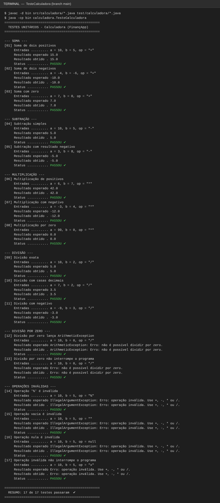
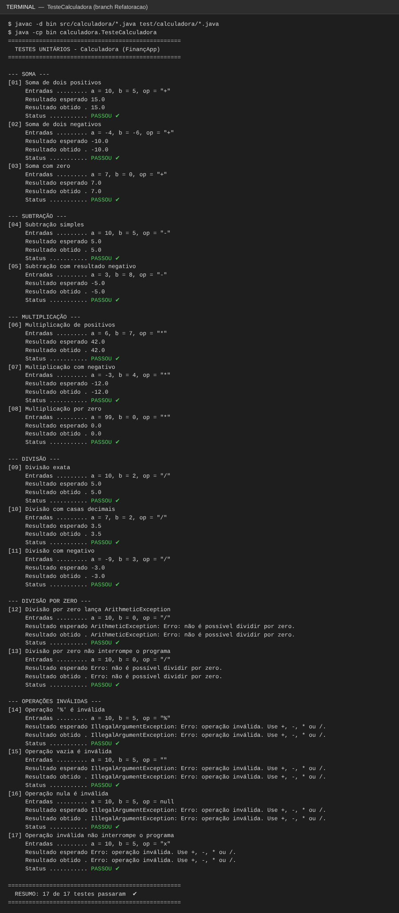
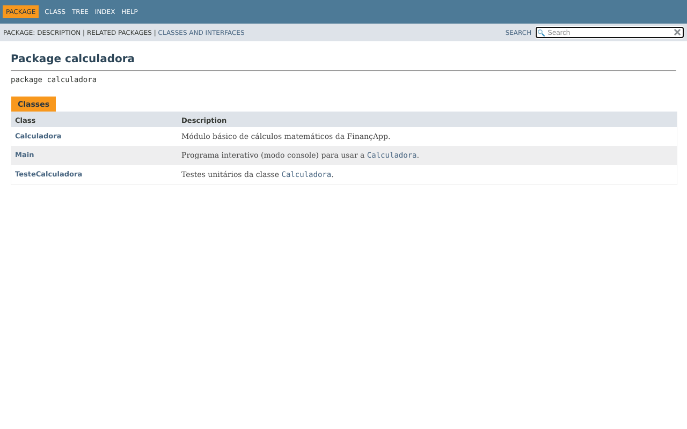

# Projeto Calculadora — FinançApp

> Projeto acadêmico desenvolvido com foco em Qualidade de Software, Testes, Refatoração, Documentação e Versionamento.

---

## 1. Identificação do Projeto

**Projeto:** Projeto Calculadora  
**Contexto:** FinançApp  
**Aluno:** Nicolas Gomes Ferreira  
**RA:** 251141  
**Curso:** Análise e Desenvolvimento de Sistemas — Centro Universitário Facens  
**Disciplina:** UX/UI e Testes de Software  
**Professor:** Daniel Ohata
**Semestre:** 2026.2  

---

# 2. Visão Geral

O projeto consiste no desenvolvimento de um módulo de cálculos matemáticos básicos em Java para a startup fictícia **FinançApp**.

O módulo foi desenvolvido com o objetivo de ser utilizado futuramente em funcionalidades de controle financeiro, como:

- orçamento mensal;
- divisão de despesas;
- projeções financeiras;
- cálculos auxiliares.

Além do funcionamento correto das operações, o projeto aplica práticas de qualidade de software relacionadas a:

- testes;
- tratamento de erros;
- refatoração;
- documentação;
- versionamento;
- manutenção de código.

---

# 3. Problema

Durante o desenvolvimento da aplicação FinançApp, foi identificada a necessidade de criar um módulo matemático reutilizável.

Entretanto, a equipe definiu que o módulo não deveria apenas funcionar corretamente, mas também apresentar:

- código legível;
- testes automatizados;
- tratamento de falhas;
- documentação técnica;
- controle de versões;
- facilidade de manutenção.

O desafio consiste, portanto, em desenvolver uma solução funcional e ao mesmo tempo aplicar boas práticas de Engenharia de Software.

---

# 4. Objetivo

## 4.1 Objetivo Geral

Desenvolver uma calculadora em Java aplicando práticas de qualidade, testes, documentação, refatoração e versionamento.

## 4.2 Objetivos Técnicos

- implementar operações matemáticas básicas;
- tratar entradas inválidas;
- impedir divisão por zero;
- desenvolver testes automatizados;
- refatorar o código sem alterar seu comportamento;
- documentar classes e métodos com JavaDoc;
- gerar documentação HTML;
- utilizar Git e GitHub;
- organizar commits e branches;
- manter documentação técnica no README.

---

# 5. Escopo Funcional

A aplicação oferece as seguintes operações:

| ID | Funcionalidade | Descrição | Status |
|---|---|---|---|
| RF01 | Soma | Soma dois números inteiros | ✅ |
| RF02 | Subtração | Subtrai dois números inteiros | ✅ |
| RF03 | Multiplicação | Multiplica dois números inteiros | ✅ |
| RF04 | Divisão | Divide dois números inteiros | ✅ |
| RF05 | Validação de divisão | Impede divisão por zero | ✅ |
| RF06 | Operação inválida | Trata operadores não suportados | ✅ |

---

# 6. Requisitos Não Funcionais

| ID | Categoria | Requisito | Como foi atendido |
|---|---|---|---|
| RNF01 | Qualidade | O código deve possuir organização e legibilidade | Indentação padronizada, nomes descritivos e código dividido em blocos lógicos |
| RNF02 | Testabilidade | As operações devem possuir testes automatizados | 17 testes em `TesteCalculadora` |
| RNF03 | Manutenção | O código deve permitir refatoração sem alteração funcional | Branch `Refatoracao` com saída de testes idêntica à da `main` |
| RNF04 | Documentação | Classes e métodos devem possuir JavaDoc | JavaDoc em todas as classes, métodos e atributos + HTML em `docs/` |
| RNF05 | Versionamento | O projeto deve utilizar Git e GitHub | Commits padronizados e branches `main` e `Refatoracao` |
| RNF06 | Confiabilidade | Erros não devem interromper inesperadamente a execução | Exceções tratadas; o programa interativo nunca encerra por erro |

---

# 7. Tecnologias Utilizadas

| Tecnologia | Versão | Utilização |
|---|---|---|
| Java | 17+ (testado com 21) | Desenvolvimento |
| JDK | OpenJDK 21 | Compilação |
| Testes | Java puro (classe `TesteCalculadora`) | Testes unitários, sem dependências externas |
| Git | 2.x | Controle de versão |
| GitHub | — | Repositório remoto |
| JavaDoc | JDK 21 | Documentação |
| IDE | Visual Studio Code + Extension Pack for Java | Ambiente de desenvolvimento |

---

# 8. Estrutura do Projeto

```text
projeto_calculadora/
│
├── src/
│   └── calculadora/
│       ├── Calculadora.java       # Classe com o método calc(int a, int b, String op)
│       └── Main.java              # Programa interativo (console)
│
├── test/
│   └── calculadora/
│       └── TesteCalculadora.java  # Testes unitários
│
├── docs/
│   └── index.html                 # Documentação JavaDoc gerada
│
├── images/
│   ├── testes/
│   ├── javadoc/
│   └── refatoracao/
│
├── .vscode/settings.json          # Configuração do projeto no VS Code
├── README.md
└── .gitignore
```

---

# 9. Funcionamento das Operações

O método principal é `calc(int a, int b, String op)`, que retorna um `double`:

| Operação | Símbolo | Exemplo | Resultado |
|---|:---:|---|---|
| Soma | `+` | `calc(10, 5, "+")` | `15.0` |
| Subtração | `-` | `calc(10, 5, "-")` | `5.0` |
| Multiplicação | `*` | `calc(6, 7, "*")` | `42.0` |
| Divisão | `/` | `calc(7, 2, "/")` | `3.5` |

O retorno é `double` para que a divisão não perca as casas decimais (7 / 2 = 3.5), o que é essencial em cálculos financeiros como divisão de despesas.

---

# 10. Tratamento de Erros

| Situação | `calc(...)` | Versão com tratamento* |
|---|---|---|
| Divisão por zero (`calc(10, 0, "/")`) | Lança `ArithmeticException` | Retorna `"Erro: não é possível dividir por zero."` |
| Operação inválida (`"%"`, `""`, `null`, `"x"`...) | Lança `IllegalArgumentException` | Retorna `"Erro: operação inválida. Use +, -, * ou /."` |
| Texto no lugar de número (no `Main`) | — | Exibe `"Erro: digite apenas números inteiros."` e continua |

\* Método `calcSeguro` na branch `main`, renomeado para `calcularComTratamento` na branch `Refatoracao`.

Dessa forma, nenhum erro interrompe a execução do programa: o `Main` usa a versão com tratamento, que captura as exceções e devolve a mensagem.

Execução do programa interativo mostrando os erros tratados sem encerrar o programa:


---

# 11. Testes

A classe `TesteCalculadora` possui **17 testes**, divididos em:

| Grupo | Qtd. | Casos testados |
|---|:---:|---|
| Soma | 3 | positivos, negativos, com zero |
| Subtração | 2 | simples, resultado negativo |
| Multiplicação | 3 | positivos, com negativo, por zero |
| Divisão | 3 | exata, com casas decimais, com negativo |
| Divisão por zero | 2 | lança exceção; versão com tratamento não interrompe o programa |
| Operações inválidas | 4 | `"%"`, vazia, `null`; versão com tratamento não interrompe o programa |

Cada teste exibe as **entradas utilizadas**, o **resultado esperado**, o **resultado obtido** e o **status** (PASSOU / FALHOU). Se algum teste falhar, o programa termina com código de saída 1.

## 11.1 Evidência da Execução dos Testes



---

# 12. Refatoração

A refatoração foi feita na branch **`Refatoracao`**, sem alterar o comportamento do sistema.

| Técnica | O que foi feito |
|---|---|
| **Extração de métodos** | Cada operação virou um método próprio: `somar`, `subtrair`, `multiplicar`, `dividir`; validações extraídas para `validarOperacao` e `validarDivisor`; montagem do texto em `montarExpressao`. No `Main`: `exibirCabecalho`, `lerEntrada` e `processar`. Nos testes: `imprimirResumo` e `todosAprovados`. |
| **Simplificação de condicionais** | A cadeia de `if / else if` foi substituída por um `switch` com `->`, e o `if/else` aninhado da divisão virou uma cláusula de guarda (`validarDivisor`). |
| **Melhoria nos nomes** | `a`, `b`, `op`, `r` → `primeiroNumero`, `segundoNumero`, `operacao`, `resultado`; `calcSeguro` → `calcularComTratamento`; `total`/`passou` → `testesExecutados`/`testesAprovados`; `ok` → `aprovado`; `sc` → `leitor`. |
| **Melhoria na legibilidade** | Símbolos das operações viraram constantes documentadas: `SOMA`, `SUBTRACAO`, `MULTIPLICACAO`, `DIVISAO`. |
| **Organização lógica** | Classe dividida em blocos: constantes → API pública → operações → validações. `Scanner` passou a ser fechado com *try-with-resources*. |

**Antes** (branch `main`):
```java
if (op.equals("+")) {
    r = (double) a + b;
} else if (op.equals("-")) {
    ...
} else if (op.equals("/")) {
    if (b == 0) {
        throw new ArithmeticException(MSG_DIVISAO_POR_ZERO);
    } else {
        r = (double) a / b;
    }
} else {
    throw new IllegalArgumentException(MSG_OPERACAO_INVALIDA);
}
return r;
```

**Depois** (branch `Refatoracao`):
```java
validarOperacao(operacao);
return switch (operacao) {
    case SOMA -> somar(primeiroNumero, segundoNumero);
    case SUBTRACAO -> subtrair(primeiroNumero, segundoNumero);
    case MULTIPLICACAO -> multiplicar(primeiroNumero, segundoNumero);
    case DIVISAO -> dividir(primeiroNumero, segundoNumero);
    default -> throw new IllegalArgumentException(MSG_OPERACAO_INVALIDA);
};
```

## 12.1 Testes Após a Refatoração

Todos os 17 testes foram executados novamente e continuam passando. A saída é idêntica à da branch `main`, o que comprova que o comportamento não foi alterado:



JavaDoc regenerado na branch `Refatoracao`, já mostrando os métodos extraídos:


---

# 13. Documentação JavaDoc

Todas as classes, métodos, atributos, parâmetros, retornos e exceções foram documentados com as tags `@author`, `@version`, `@param`, `@return` e `@throws`. A documentação HTML foi gerada na pasta `docs/` e pode ser aberta pelo arquivo `docs/index.html`.

Comando utilizado:

```bash
javadoc -d docs -sourcepath "src:test" -subpackages calculadora -private -author -version -encoding UTF-8 -docencoding UTF-8 -charset UTF-8
```

> No Windows, troque `"src:test"` por `"src;test"`.

## 13.1 Página Inicial (`docs/index.html`)



## 13.2 Classe `Calculadora`


## 13.3 Método `calc` (`@param`, `@return` e `@throws`)


---

# 14. Versionamento

| Branch | Conteúdo |
|---|---|
| `main` | Implementação inicial, tratamento de erros, testes, JavaDoc e README |
| `Refatoracao` | Código reorganizado com técnicas de refatoração; testes reexecutados com o mesmo resultado |

Os commits seguem um padrão descritivo:

| Prefixo | Uso |
|---|---|
| `feat` | Nova funcionalidade |
| `test` | Criação de testes |
| `refactor` | Refatoração sem mudança de comportamento |
| `docs` | Documentação (JavaDoc e README) |
| `chore` | Estrutura e organização do projeto |

---

# 15. Como Executar

## 15.1 No VS Code

1. Instale o **JDK 17 ou superior** e a extensão **Extension Pack for Java**.
2. Abra a pasta `projeto_calculadora` no VS Code.
3. Abra `test/calculadora/TesteCalculadora.java` (ou `src/calculadora/Main.java`) e clique em **Run** acima do método `main`.

## 15.2 Pelo Terminal

```bash
# Compilar
javac -d bin src/calculadora/*.java test/calculadora/*.java

# Executar os testes
java -cp bin calculadora.TesteCalculadora

# Executar a calculadora interativa
java -cp bin calculadora.Main
```

> No Windows, se acentos ou o símbolo ✔ aparecerem como `?`, rode `chcp 65001` no terminal antes de executar.

---

# 16. Repositório

🔗 https://github.com/Anumlox/projeto_calculadora
