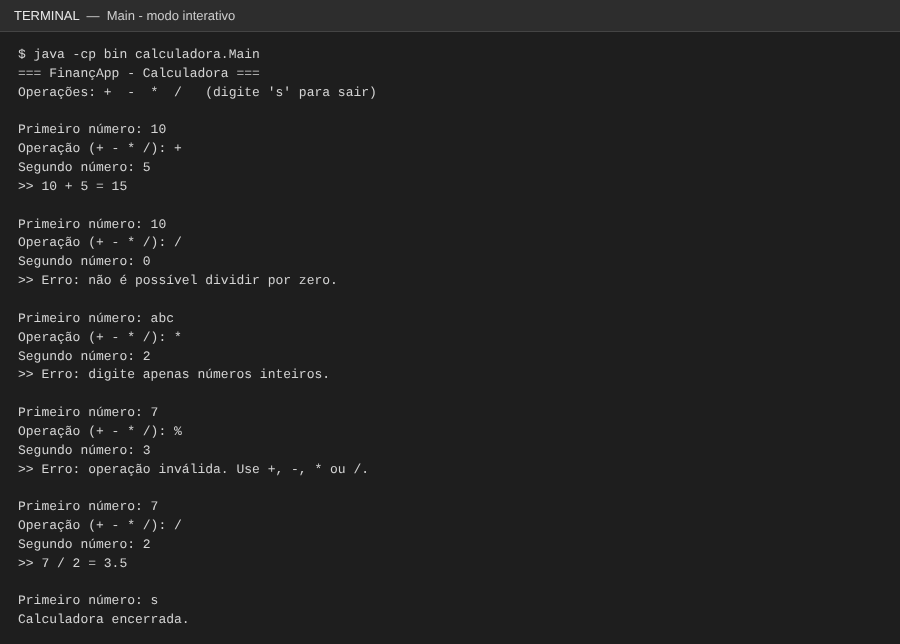
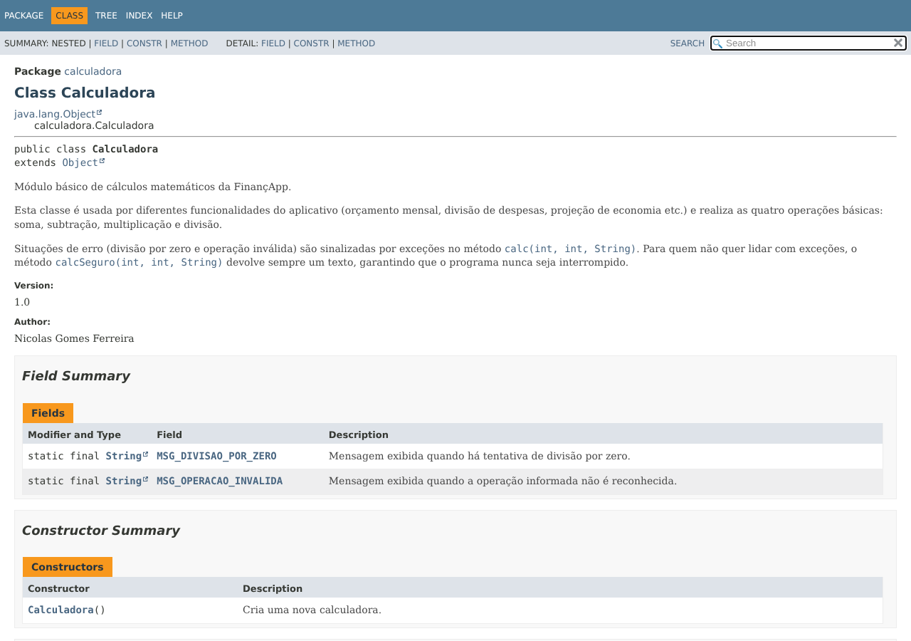
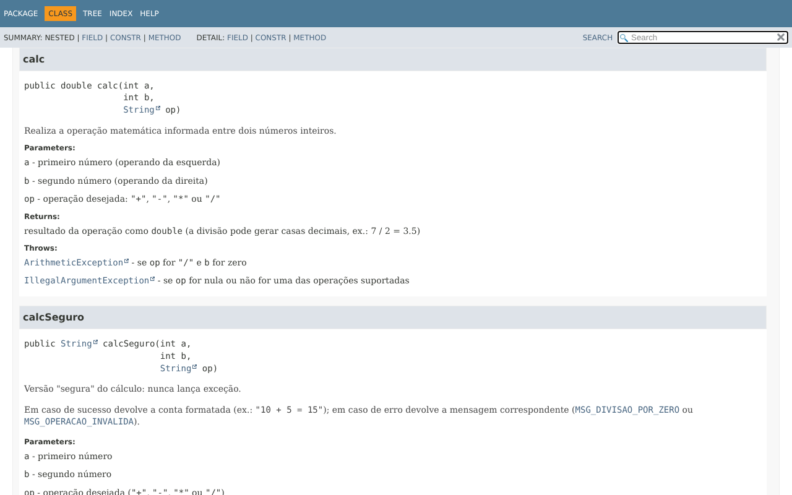
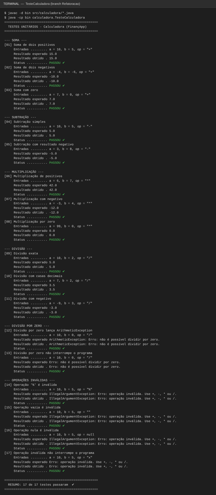
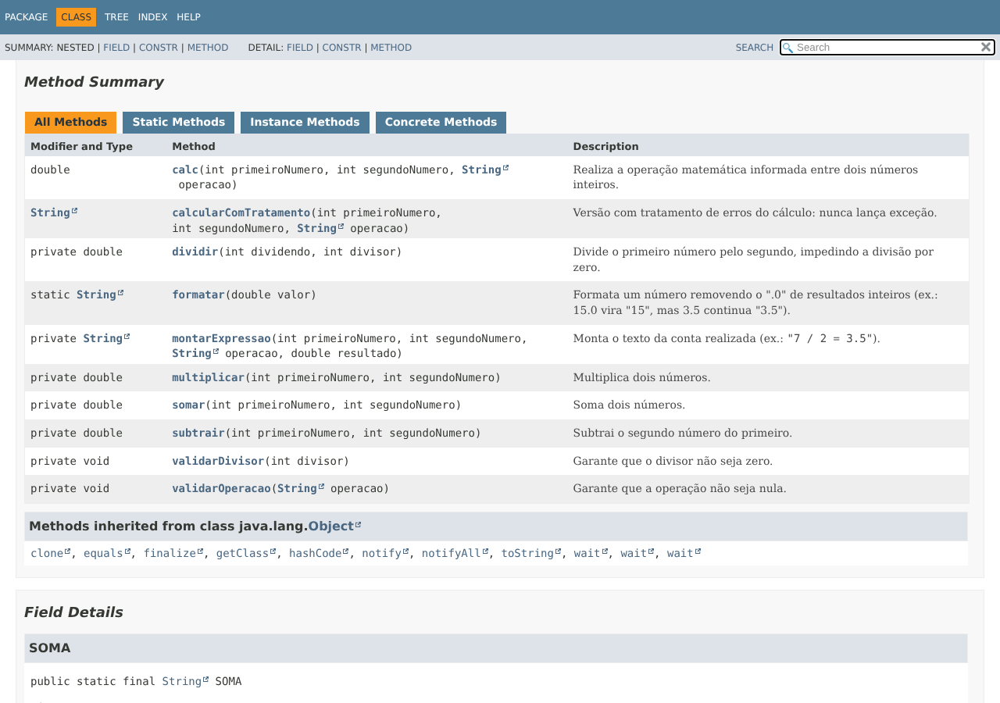

# 🧮 Calculadora FinançApp — `projeto_calculadora`

## 📌 Descrição do Projeto

Módulo básico de cálculos matemáticos desenvolvido para a startup fictícia **FinançApp**, que cria um aplicativo mobile de controle de finanças pessoais. A calculadora será reutilizada em funcionalidades como cálculo de orçamento mensal, divisão de despesas, projeção de economia e cálculos básicos do sistema.

O projeto é uma aplicação **Java** com a classe `Calculadora` (operações + tratamento de erros), uma classe de testes unitários `TesteCalculadora`, um programa interativo de console `Main` e a documentação técnica gerada com **JavaDoc**.

## 🎯 Objetivo da Atividade

Aplicar na prática conceitos de qualidade de software:

- testes funcionais e testes unitários;
- tratamento de erros;
- refatoração de código (branch `Refatoracao`);
- documentação técnica (comentários + JavaDoc);
- versionamento com Git e GitHub (commits organizados e branches).

## 🛠️ Tecnologias Utilizadas

| Tecnologia | Uso |
|---|---|
| **Java 17+** (testado com JDK 21) | Linguagem do projeto |
| **Visual Studio Code** + *Extension Pack for Java* | IDE de desenvolvimento |
| **JavaDoc** | Geração da documentação HTML (`docs/`) |
| **Git** | Versionamento (branches `main` e `Refatoracao`) |
| **GitHub** | Repositório remoto |

## 📁 Estrutura do Projeto

```
projeto_calculadora/
├── src/
│   └── calculadora/
│       ├── Calculadora.java       # Classe principal com o método calc(int a, int b, String op)
│       ├── TesteCalculadora.java  # Testes unitários
│       └── Main.java              # Programa interativo (console)
├── docs/                          # Documentação JavaDoc gerada (abrir docs/index.html)
├── imagens/                       # Prints usados neste README
├── .vscode/settings.json          # Configuração do projeto Java no VS Code
├── .gitignore
└── README.md
```

## ➗ Explicação das Operações

O método principal é `calc(int a, int b, String op)`, que retorna um `double`:

| Operação | Símbolo | Exemplo | Resultado |
|---|:---:|---|---|
| Soma | `+` | `calc(10, 5, "+")` | `15.0` |
| Subtração | `-` | `calc(10, 5, "-")` | `5.0` |
| Multiplicação | `*` | `calc(6, 7, "*")` | `42.0` |
| Divisão | `/` | `calc(7, 2, "/")` | `3.5` |

> O retorno é `double` para que a divisão não perca as casas decimais (7 / 2 = 3.5), algo essencial em cálculos financeiros como divisão de despesas.

### Tratamento de erros

| Situação | Comportamento de `calc(...)` | Comportamento de `calcularComTratamento(...)` |
|---|---|---|
| Divisão por zero (`calc(10, 0, "/")`) | Lança `ArithmeticException` | Retorna `"Erro: não é possível dividir por zero."` |
| Operação inválida (`"%"`, `""`, `null`, `"x"`...) | Lança `IllegalArgumentException` | Retorna `"Erro: operação inválida. Use +, -, * ou /."` |
| Texto no lugar de número (no `Main`) | — | O `Main` exibe `"Erro: digite apenas números inteiros."` e continua |

Dessa forma, nenhum erro interrompe a execução do programa: o `Main` usa `calcularComTratamento`, que captura as exceções e devolve a mensagem.

## ▶️ Como Executar

### No VS Code
1. Instale o **JDK 17 ou superior** e a extensão **Extension Pack for Java**.
2. Abra a pasta `projeto_calculadora` no VS Code.
3. Abra `TesteCalculadora.java` (ou `Main.java`) e clique em **Run** acima do método `main`.

### Pelo terminal
```bash
# Compilar
javac -d bin src/calculadora/*.java

# Executar os testes
java -cp bin calculadora.TesteCalculadora

# Executar a calculadora interativa
java -cp bin calculadora.Main
```

> 💡 No Windows, se acentos ou o símbolo ✔ aparecerem como `?`, rode `chcp 65001` no terminal antes de executar.

### Gerar a documentação JavaDoc
```bash
javadoc -d docs -sourcepath src -subpackages calculadora -private -author -version -encoding UTF-8 -docencoding UTF-8 -charset UTF-8
```
Depois abra `docs/index.html` no navegador.

## ✅ Prints da Execução dos Testes

Os testes mostram, para cada caso, as **entradas utilizadas**, o **resultado esperado**, o **resultado obtido** e o **status**. São 17 testes cobrindo soma, subtração, multiplicação, divisão, divisão por zero e operações inválidas.


### Execução do programa interativo (`Main`)

Mostra que divisão por zero, texto no lugar de número e operação inválida geram mensagens sem interromper o programa:



## 📚 Prints da Documentação JavaDoc

Página inicial (`docs/index.html`):


Página da classe `Calculadora` (descrição, `@author`, `@version` e atributos):



Detalhe do método `calc` (`@param`, `@return` e `@throws`):



## 🔧 Refatoração (branch `Refatoracao`)

Nesta branch o código foi reorganizado **sem alterar o comportamento** do sistema.

| Técnica | O que foi feito |
|---|---|
| **Extração de métodos** | Cada operação virou um método próprio: `somar`, `subtrair`, `multiplicar`, `dividir`; validações extraídas para `validarOperacao` e `validarDivisor`; montagem do texto em `montarExpressao`. No `Main`: `exibirCabecalho`, `lerEntrada` e `processar`. Nos testes: `imprimirResumo` e `todosAprovados`. |
| **Simplificação de condicionais** | A cadeia de `if / else if` foi substituída por um `switch` com `->`, e o `if/else` aninhado da divisão virou uma cláusula de guarda (`validarDivisor`). |
| **Melhoria nos nomes** | `a`, `b`, `op`, `r` → `primeiroNumero`, `segundoNumero`, `operacao`, `resultado`; `calcSeguro` → `calcularComTratamento`; `total`/`passou` → `testesExecutados`/`testesAprovados`; `ok` → `aprovado`; `sc` → `leitor`. |
| **Eliminação de "números mágicos"** | Símbolos das operações viraram constantes documentadas: `SOMA`, `SUBTRACAO`, `MULTIPLICACAO`, `DIVISAO`. |
| **Organização lógica** | Classe dividida em blocos: constantes → API pública → operações → validações. `Scanner` passou a ser fechado com *try-with-resources*. |

**Antes** (branch `main`):
```java
if (op.equals("+")) {
    r = (double) a + b;
} else if (op.equals("-")) {
    ...
} else if (op.equals("/")) {
    if (b == 0) {
        throw new ArithmeticException(MSG_DIVISAO_POR_ZERO);
    } else {
        r = (double) a / b;
    }
} else {
    throw new IllegalArgumentException(MSG_OPERACAO_INVALIDA);
}
return r;
```

**Depois** (branch `Refatoracao`):
```java
validarOperacao(operacao);
return switch (operacao) {
    case SOMA -> somar(primeiroNumero, segundoNumero);
    case SUBTRACAO -> subtrair(primeiroNumero, segundoNumero);
    case MULTIPLICACAO -> multiplicar(primeiroNumero, segundoNumero);
    case DIVISAO -> dividir(primeiroNumero, segundoNumero);
    default -> throw new IllegalArgumentException(MSG_OPERACAO_INVALIDA);
};
```

### Testes reexecutados após a refatoração

Todos os 17 testes foram executados novamente e continuam passando — a saída é idêntica à da branch `main`:



JavaDoc regenerado, já mostrando os métodos extraídos:



## 🌿 Branches e Versionamento

| Branch | Conteúdo |
|---|---|
| `main` | Implementação inicial, testes, JavaDoc e README |
| `Refatoracao` | Código reorganizado com técnicas de refatoração; testes reexecutados com o mesmo resultado |

Os commits seguem um padrão descritivo (`feat`, `test`, `docs`, `refactor`, `chore`) para manter o histórico organizado.

## 🔗 Link do Repositório

https://github.com/Anumlox/projeto_calculadora

## 👤 Autor

**Nicolas Gomes Ferreira** — Análise e Desenvolvimento de Sistemas, Centro Universitário Facens
GitHub: [@Anumlox](https://github.com/Anumlox)
